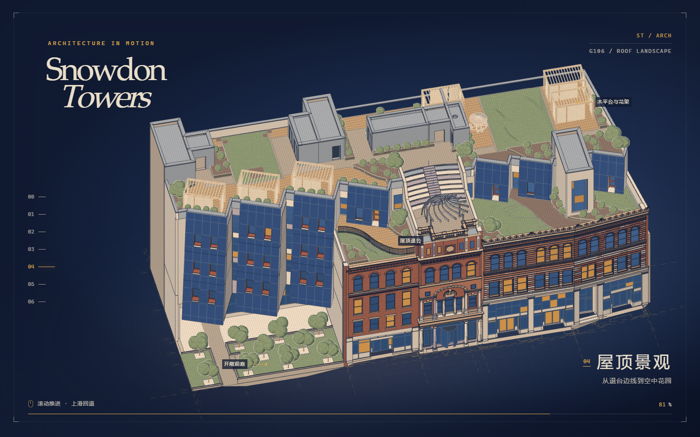

# Snowdon Towers — Architecture in Motion

一个滚动驱动的建筑叙事网页样机。从 C101 矢量场地总平面出发，镜头聚焦建筑，墙体和楼板从图纸原位升起。线稿随后转成蚀刻版画式三维画面，接上屋顶景观生长、环视和解构。



## 本地启动

技术栈为 Three.js、GSAP ScrollTrigger 和 Vite。需要支持 WebGL 2 的浏览器和 Node.js 20.19+ 或 22.12+。

```sh
npm ci
npm run dev
```

打开 [http://127.0.0.1:4183/](http://127.0.0.1:4183/)。Windows 也可以双击 [打开本地样机.cmd](打开本地样机.cmd)。运行 `npm run build` 生成静态构建产物。

## 当前快照

已实现从 C101 绘线、建筑聚焦和生长，到三渲二实体、G106 屋顶景观、环视和分层解构。所有阶段由同一条滚动时间轴驱动，支持倒放、停驻及左侧刻度跳转。

[场地总平面](previews/00-C101.png) · [聚焦建筑](previews/01-Focus.png) · [建筑长成](previews/02-Rise.png) · [解构](previews/06-Exploded.png)

## 模型来源与生成

场地线稿来自 C101 的 DXF 导出，采用与三维模型相同的 Revit 项目坐标。建筑使用 `3D (Shaded) Uncropped` 原视图的可见构件，屋顶景观以 G106 和模型中的构件位置为依据，植物以简化冠形表现。模型和图纸来自 [Autodesk 的 Snowdon Towers Revit 建筑与场地样例](https://help.autodesk.com/cloudhelp/2026/ENU/Revit-GetStarted/files/GUID-61EF2F22-3A1F-4317-B925-1E85F138BE88.htm)。仓库提供网页几何、生成所需的中间数据和可编辑 Blender 建筑底模。原始 RVT 文件可从 Autodesk 获取。

`src/` 包含场景、时间轴、材质和布局。`assets/` 包含运行所需模型，`tools/` 包含 Revit 提取和几何转换源码。运行网页无需 Revit 或 Blender。重新生成网页资产需要 Python、NumPy 和 ezdxf。

```sh
python tools/prepare_geometry.py assets/revit-source assets/snowdon.sdt
python tools/prepare_site_plan.py assets/revit-source/C101-model.dxf.gz assets/revit-source/C101-coords.json assets/site-plan.json
python tools/prepare_landscape.py assets/revit-source assets/revit-source/roof-landscape assets/landscape.sdl
```
